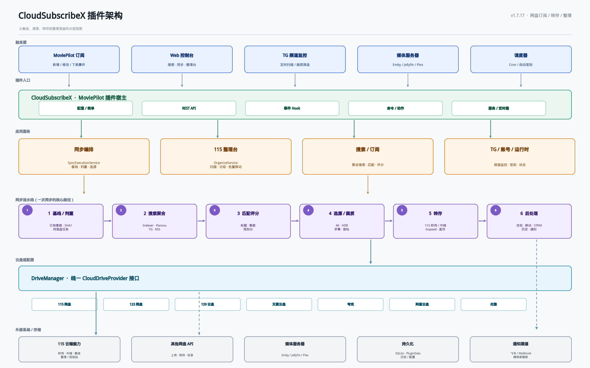
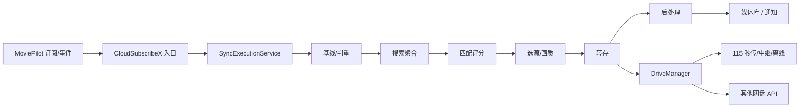
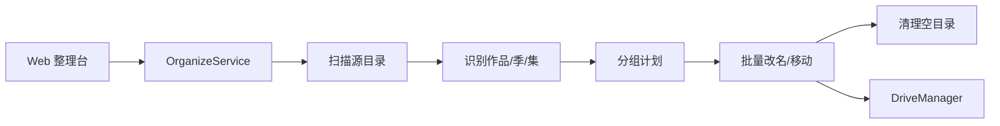

# CloudSubscribeX 插件架构（v1.7.17）

## 分层说明

| 层 | 作用 | 主要入口 |
| --- | --- | --- |
| 触发层 | 决定“什么时候开始工作” | MoviePilot 订阅事件、Web 控制台、TG 频道监控、媒体服务器 Webhook、Cron/签到 |
| 插件入口 | 把外部请求翻译成插件动作 | 配置表单、REST API、事件 Hook、命令/动作、服务/定时器 |
| 应用服务 | 各自独立的业务编排 | 同步编排、115 整理台、搜索/订阅、TG/账号/运行时 |
| 同步流水线 | 一次同步从判重到落盘 | 基线判重 → 搜索聚合 → 匹配评分 → 选源/画质 → 转存 → 后处理 |
| 云盘适配层 | 用统一接口屏蔽网盘差异 | `DriveManager` + `CloudDriveProvider`（115/123/139/天翼/夸克/阿里/光雅） |
| 外部系统/存储 | 真正执行与持久化 | 115 秒传/中继/离线、其他网盘 API、Emby/Jellyfin/Plex、SQLite/PluginData、通知渠道 |

## 核心数据流

## 115 整理台是独立链路

整理台不经过订阅搜索流水线；它只处理“已经在网盘里的文件”，负责改名、移动、清理空目录。
